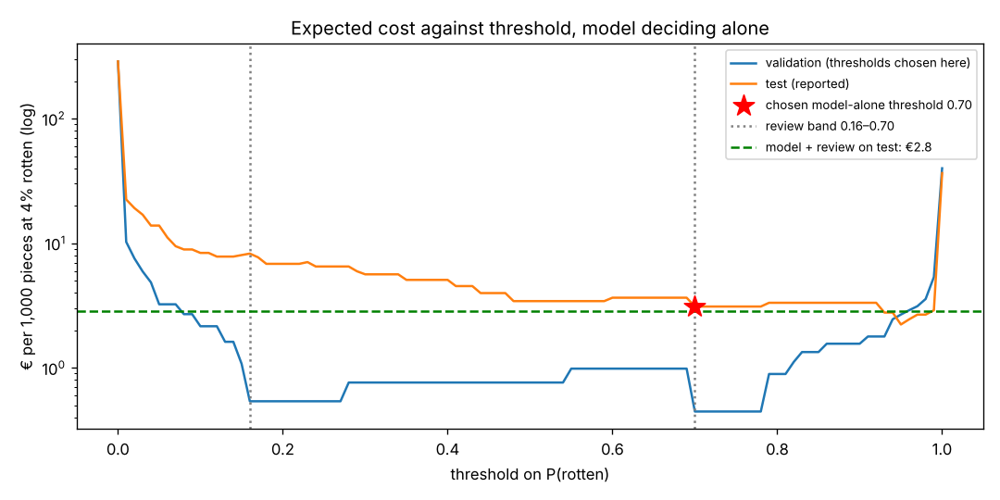

# Assignment 2 Report

- **Name**: Sebastián Delgado-Aparicio
- **Student ID**: 20013
- **Email**: sdelgadoapar.ieu2022@student.ie.edu
- **Group**: BBADBA 5B

## Business problem, and the cost of being wrong

I picked a decision that people make by eye thousands of times a day: on a
fruit packing line, is this piece of fruit good enough to ship, or does it go
in the bin?

**How it works today.** Two graders stand at the conveyor and pull off
anything that looks bad as the fruit rolls past. At 2 pieces a second, each
of them sees roughly one piece per second: a glance, not an inspection. Human
visual inspection catches about 80% of defects on average; even careful,
trained inspectors in a Sandia study only reached 85%
([See et al., Sandia/OSTI](https://www.osti.gov/biblio/1236203)). So I assume
today's graders catch **80%** of rotten pieces and wrongly pull off 3% of good
ones.

**What I propose.** A camera over the conveyor, and a model that gives every
piece a probability of being rotten. That probability sends the piece to one
of three places:

- **pass**: it goes into a retail pack and ships;
- **review**: it is pushed into a tray at the grading table, where a grader
  picks it up, turns it over and decides;
- **fail**: it is knocked off into the waste or juice bin.

The line supervisor sets the two thresholds. The graders stop glancing at
everything and instead look carefully at the few pieces the model is unsure
about.

The two mistakes are very different in price, which is what makes this
problem interesting:

| outcome | cost per piece | where the number comes from |
|---|---|---|
| Rotten piece shipped (false negative) | **€4.00** | The rot is found in a supermarket pack and the packer pays twice. First, the 1 kg pack is written off: about €1.75 at Spanish wholesale prices ([Tridge](https://www.tridge.com/market-overview/fresh-apple/ES); it retails at about €2.76/kg, [Expatistan](https://expatistan.com/price/apples/madrid)). Second, some shoppers complain, and UK supermarkets charge suppliers £45–55 per consumer complaint ([Fruitnet, on the Groceries Code Adjudicator](https://www.fruitnet.com/fpj/article/165630/tacon-to-close-one-of-her-top-five-retail-supplier-issues)). With a 5% chance of a complaint at about €50, that adds €2.50. €1.75 + €2.50 ≈ €4.25, which I round to €4. |
| Fresh piece binned (false positive) | **€0.30** | We threw away a piece we could have sold: about €1.75 per kg wholesale at roughly six pieces per kg. Cheaper varieties trade at €0.70–1.00/kg ([Wikifarmer](https://wikifarmer.com/library/en/article/fresh-market-digest-week-50)), so €0.30 is at the high end. That is deliberate: it makes false alarms look more expensive, which works against the model, not for it. |
| Rotten piece binned (true positive) | €0 | It was worth nothing before the camera saw it. Binning it is the right, free outcome. |
| Fresh piece shipped (true negative) | €0 | Business as usual. |
| One careful review | €0.012 | 3 seconds of a grader at about €14 an hour fully loaded. Packing-house wages in Spain are tied to the minimum wage ([CSIF Granada](https://www.csif.es/es/noticia/portada/granada/articulo/81210)): €1,184 a month in 14 payments in 2025, roughly €9.30 an hour. Employer social security of about 31% and a little overhead take that to €14. I assume a grader holding one flagged piece catches **90%** of rot, a bit better than Sandia's 85% because one fruit in the hand is an easier call than a complex part, and wrongly bins 5% of good pieces. |

So shipping one rotten piece costs about **13 times** as much as binning a good
one. That ratio drives everything that follows:

- **It sets where the cut should be.** A piece should be binned once its chance
  of being rotten passes 0.30 / (0.30 + 4.00), about 7%, not the default 50%.
- **It sets what to measure.** Recall on the rotten classes matters more than
  overall accuracy. Mixing up a fresh apple and a fresh orange costs nothing;
  calling a rotten orange fresh costs €4.
- **It sets how to choose the threshold.** I sweep cost, rather than picking the
  threshold that looks best on accuracy.

**Volume and base rate.** I assume one line at 2 pieces per second over an
8-hour shift: **57,600 pieces a day**, and that **4%** of incoming fruit is
actually rotten. The two graders have about 7 productive hours each, so a
careful 3-second look fits at most 16,800 pieces a day, 29% of the line's
volume. Checking *every* piece that carefully would take 48 hours of work a
day, or 6.9 graders. That is why it doesn't happen today, and why careful
checks have to be targeted.

## Dataset

**Roboflow Universe:** workspace `rishwanths-workspace`, project
`freshness-of-fruits`, **version 3**. It is an image classification project,
CC BY 4.0, used exactly as published (not forked):
https://universe.roboflow.com/rishwanths-workspace/freshness-of-fruits/dataset/3

Each image shows one piece (occasionally a bunch) of fruit, labelled with one
of six classes: `freshapples`, `freshbanana`, `freshoranges`, `rottenapples`,
`rottenbanana`, `rottenoranges`. Version 3 has no Roboflow resizing or
augmentation, so the images are the originals at their own sizes: 1,451
different sizes, mostly 350–560 px wide.

**Why this dataset.** It labels exactly the call a grader makes, fresh or
rotten, for three fruits a real line would handle. Because it keeps the fruit
type, I can check whether the model is worse on one fruit than another instead
of only looking at an average.

**Alternatives I compared** (through the Roboflow API) and rejected:

| dataset | why I did not use it |
|---|---|
| `anil-ozkan2/meyve` v1 | 3,347 real images inflated to 8,033 with mosaic and crop augmentation |
| `zahrabahadori/fresh-and-rotten-fruit` | Messy class names, and only 31–77 images for some fruits |
| `11thsacred/fruit-freshness-detection` | Only 96 images |
| `project-ta/fruit-freshness-detection` | Object detection, not classification |
| `university-of-mines-and-technology/fruits` | Classes named just `0` and `1` |

**Where it does not match the problem.** These are web and stock photos, not
conveyor photos. Fresh fruit is mostly glossy studio shots on white, often with
a leaf or water droplets. Rotten fruit is mostly very obviously rotten: thick
mould, black bananas. The hard case on a real line, an early bruise, barely
appears. None of the public candidates had conveyor images, so I chose the
cleanest one and treat its results as a best case throughout.

## What the dataset's composition implies

**The first thing I found was that the published splits leak.** Most of the
8,195 images were already augmented by the dataset's original author, and the
filenames give it away: `rotated_by_75_…`, `vertical_flip_…`, `saltandpepper_…`,
`translation_…`. Strip those prefixes and only **1,513 distinct photos** remain,
about 5.4 copies of each.

In the split as published, **99.1% of validation images and 99.4% of test
images are a copy of a photo that is also in training.** A test score on that
split would mostly measure whether the model recognises a photo it has already
seen, just rotated.

So my pipeline re-splits the downloaded images by source photo:
- every copy of one photo lands in the same split;
- the split is done per class, with a fixed seed;
- the shares are 70 / 15 / 15 by image count.

Nothing on Roboflow is changed; only my local assignment of images to splits.
After this, no validation or test photo shares a source with training. As a
second check, I hashed every image and compared pixels: only 5 of the 1,242
test images (0.4%) still look near-identical to a training image.

| split | images | distinct photos | fresh apple | fresh banana | fresh orange | rotten apple | rotten banana | rotten orange | rotten share |
|---|---|---|---|---|---|---|---|---|---|
| train | 5,702 | 1,049 | 851 | 808 | 763 | 1,266 | 1,160 | 854 | 57.5% |
| val | 1,251 | 230 | 185 | 178 | 171 | 273 | 253 | 191 | 57.3% |
| test | 1,242 | 234 | 185 | 174 | 165 | 275 | 254 | 189 | 57.8% |

The published split (not used) was train 6,165 / valid 1,223 / test 807.

What I take from this:

- **The real sample size is photos, not images.** The test set has 1,242
  images but only 234 independent photos, around 39 per class. A recall
  measured on 39 photos carries an uncertainty of roughly ±10 points, so I
  will not read anything into per-class differences smaller than that.
- **No class is too thin to train on.** The classes are reasonably balanced,
  from 763 to 1,266 training images. Fresh oranges and fresh bananas are the
  smallest.
- **Rotten is 57% of the data but about 4% of a real line.** Accuracy on this
  test set therefore says little about cost on the line. I compute every cost
  from the model's rates on rotten and on fresh fruit separately, then
  re-weight them to 4%.
- **Object size is not a concern.** This is classification and the fruit fills
  most of the frame in almost every image, which is also how a camera mounted
  over a conveyor would frame it.
- **The test split does not look like production, so the results are an upper
  bound.** Studio "fresh" photos against amateur "rotten" photos invite a
  shortcut: the model can learn the photo style instead of the rot. And
  because the rot is mostly advanced, the test set cannot tell me how the
  model handles a small bruise under conveyor lighting. That is the case that
  costs money.

## Finetuning and baselines

I treated this as **image classification** with `yolo11n-cls`, finetuned from its
ImageNet checkpoint:
- **Why classification:** one image is one piece and the decision is made per
  piece, so there is nothing to locate.
- **Why the nano model:** it is enough for six visually distinct classes, and
  it classifies an image in about 3 ms on a CPU. That matters on a line that
  moves two pieces a second.

**Where and how I trained it:**
- **Machine:** the Claude Code cloud sandbox: a 4-core Intel Xeon CPU, no GPU,
  PyTorch 2.14 (CPU build), Ultralytics 8.4.183.
- **Settings:** 30 epochs at 224 px, batch 64, AdamW at a learning rate of
  0.001 (chosen automatically by Ultralytics), early-stopping patience 10,
  seed 0. It took 65 minutes.
- **Best epoch:** validation accuracy peaked at epoch 20 (99.8%), and that
  epoch is the `weights/best.pt` I committed.
- **Reproducing it:** `uv run python main.py train` repeats everything end to
  end, from download to the files the dashboard reads.

Results on the same test split (1,242 images, 234 independent photos):

| model | accuracy (6 classes) | right fruit type | macro precision | macro recall | macro F1 | rotten-vs-fresh ROC AUC |
|---|---|---|---|---|---|---|
| **finetuned yolo11n-cls** | **0.986** | **0.994** | **0.985** | **0.985** | **0.985** | **0.999** |
| COCO `yolo11n`, zero-shot | 0.473 | 0.783 | 0.323 | 0.519 | 0.391 | 0.500 |
| majority class (`rottenapples`) | 0.221 | 0.370 | 0.037 | 0.167 | 0.060 | 0.500 |

Ultralytics' own validator gives the same 0.986 on the test split, so my
evaluation code and theirs agree.

**How I built the baselines.**

- **COCO zero-shot.** The pretrained COCO detector knows *apple*, *banana* and
  *orange*, but has no idea what rot is.
  - Its most confident fruit detection becomes the *fresh* class of that
    fruit. If it sees no fruit at all, it gets the majority class, just so
    every image has a label.
  - **What it does well:** it names the fruit correctly 78% of the time.
  - **What it cannot do:** rot is invisible to it, so its rotten score is the
    same for every image and its rotten-vs-fresh AUC is exactly 0.5.
  - As a business decision, COCO zero-shot is no better than shipping
    everything.
  - So knowing *which fruit* it is comes almost for free. Telling *fresh from
    rotten* is entirely what the finetuning adds.
- **Majority class.** It calls everything a rotten apple. As a business
  decision, that means binning every piece on the line.

**Was the gap what I expected?** The model beats both baselines by a wide
margin. But 98.6% is higher than I would trust a nano model to reach on a real
line. Even with the leak removed, this dataset is easy: badly rotten fruit next
to studio shots of perfect fruit. I read 98.6% as a ceiling, not a forecast.

## Per-class evaluation and failure modes

I treat **rotten** as the positive class: `rottenapples`, `rottenbanana` and
`rottenoranges` together. The model's rotten score is the sum of those three
probabilities.

| class | test images | precision | recall | F1 |
|---|---|---|---|---|
| freshapples | 185 | 0.989 | 1.000 | 0.995 |
| freshbanana | 174 | 0.983 | 1.000 | 0.991 |
| **freshoranges** | 165 | 0.963 | **0.952** | 0.957 |
| rottenapples | 275 | 1.000 | 0.996 | 0.998 |
| rottenbanana | 254 | 0.984 | 0.992 | 0.988 |
| **rottenoranges** | 189 | 0.989 | **0.968** | 0.979 |

Confusion matrix on test (rows are the true class, columns the prediction):

| | fresh apple | fresh banana | fresh orange | rotten apple | rotten banana | rotten orange |
|---|---|---|---|---|---|---|
| fresh apple | 185 | 0 | 0 | 0 | 0 | 0 |
| fresh banana | 0 | 174 | 0 | 0 | 0 | 0 |
| fresh orange | 2 | 1 | 157 | 0 | 3 | 2 |
| rotten apple | 0 | 0 | 0 | 274 | 1 | 0 |
| rotten banana | 0 | 2 | 0 | 0 | 252 | 0 |
| rotten orange | 0 | 0 | 6 | 0 | 0 | 183 |

(Ultralytics' version of the same matrix is in
`artifacts/plots/test_confusion_matrix.png`.)

**What carries the headline and what drags it.**
- **Apples and bananas carry the 98.6%.** Fresh apples and fresh bananas are
  never misclassified, and every rotten apple is called rotten.
- **Oranges drag it down.** Fresh oranges are the weakest class (95.2%
  recall). The most expensive confusion in the table is rotten orange called
  fresh orange: 6 images, each of which would ship a rotten piece.

**The errors are not spread out; they come in clumps.** All 17 misclassified
test images come from just **6 photos**, and the 7 decisions that actually cost
money come from **4 photos**. So the per-class numbers above rest on a handful
of independent mistakes; one more bad photo would move a recall by one to
three points. I looked at each of the four, and each tells a different story
(they are listed in `artifacts/errors_test.csv` and in the dashboard):

1. **A shrivelled, dried-out orange with no mould gets shipped** (4 of its 7
   copies pass; the other 3 go to review). The model has learned "rotten
   orange = white or green mould" and does not recognise drying out as rot.
   This is the failure I would worry about most on a real line.
2. **A black banana photographed on a bright yellow studio backdrop gets
   shipped** (one copy). The studio look reads as "fresh". This is the
   photo-style shortcut I was worried about in the dataset section, showing
   up in practice.
3. **A heap of fresh oranges, rotated with black corners, gets binned.** It
   is not a single piece of fruit, so it is outside what the line would show.
4. **A fresh orange with a dried brown leaf attached gets binned.** The leaf
   reads as rot.

The other confusions, such as rotten apple → rotten banana or fresh orange →
fresh apple, cost nothing. The decision only cares about fresh against rotten.

## Cost matrix and operating point

The costs per piece, from the business section:

| actual \ decision | ship (pass) | grading table (review) | bin (fail) |
|---|---|---|---|
| rotten | **€4.00** (FN) | €0.012 + 10% × €4.00 (grader misses it) | €0 (TP) |
| fresh | €0 (TN) | €0.012 + 5% × €0.30 (grader bins it) | **€0.30** (FP) |

**Base rate: 4% of incoming pieces are rotten.** The test split is 57.8%
rotten, so reading costs straight off the test counts would make catching rot
look about 14 times more valuable than it is. I compute the model's catch rate
on rotten fruit and its false-alarm rate on fresh fruit separately, then
re-weight them to the 4% line.

**How I picked the threshold.**
- I swept the threshold on the rotten score from 0 to 1 in steps of 0.01, on
  the **validation** split, and computed the expected cost per 1,000 pieces at
  every step.
- The cheapest point was **0.70**. I then report what 0.70 costs on the
  **test** split, which played no part in choosing it.

The same curve is live in the dashboard, where you can move the base rate and
the cost of a missed rotten piece and watch it change. The sweep data is in
`artifacts/cost_sweep.csv`.

**The curve is flat in the middle, so I need a tie-breaker, and theory gives
one.**
- **The shape.** Every threshold between about 0.16 and 0.95 costs between €2
  and €8 per 1,000 pieces on test. Below 0.05 the model bins most of the
  fresh fruit; at 1.0 a quarter of the rotten fruit ships.
- **Why it's flat.** The model makes so few mistakes on this data that one or
  two photos decide exactly where the minimum falls. That is why validation
  says 0.70 and test would say 0.95. The data alone cannot pin the threshold
  down.
- **The tie-breaker.** The break-even chance of being rotten is 7%. The model
  was trained on 57.5% rotten images, while the line sees 4%. Shifting the 7%
  by that difference in odds puts the cut on the model's score at 0.71.
- **The decision.** I keep **0.70** because two independent methods agree on
  it: the validation sweep and the theory. The theory doesn't depend on which
  handful of photos happened to land in validation.

At 0.70, with the model deciding alone, the test split gives:
- 98.7% of rotten pieces binned and 0.4% of fresh pieces wrongly binned;
- an expected **€3.1 per 1,000 pieces**. Bootstrapping by photo rather than by
  image (copies of one photo are not independent) puts the 95% range at
  €0.4–7.2.

**How the answer changes with my assumptions.** I re-ran the whole choice
(thresholds re-picked on validation, cost measured on test) for 45 scenarios:
shipped-rotten costs from €0.50 to €20 and base rates from 1% to 15%. The full
table is in `artifacts/sensitivity.csv`.

- **The threshold moves when rot becomes more expensive or more common.** At a
  4% base rate it stays at 0.70 until a shipped rotten piece costs about €6.
  If 8% of the fruit is rotten, it moves once the penalty passes €3; at 15%,
  once it passes €2. Past those points the cheapest threshold drops to 0.16:
  the model should bin more aggressively.
- **The review band pays off once rot is expensive enough.** At a 4% base
  rate it beats the model alone once a shipped rotten piece costs more than
  about €3. At a 2% base rate it needs about €6, and at 1% about €12. Below
  those points, the reviews cost more than the few mistakes they catch.
  Wherever the threshold drops to 0.16, the band saves €4–6 per 1,000 pieces.
- **The model beats both human options in every scenario.** In all 45, the
  model (alone or with review) costs at most a fifth of today's process, and
  at most a fifth of having graders check every piece carefully.

**The assumption that would change my answer most is not a euro figure. It is
how often the model misses rot on real conveyor fruit.**
- Today's process costs €44.5 per 1,000 pieces. The model beats it as long as,
  roughly, 160 × miss rate + 288 × false-alarm rate stays below 44.5.
- With false alarms around 0.4%, that means it can afford to miss up to about
  **a quarter of rotten pieces** in production.
- On this test it misses 0.8% (with review) to 1.3% (alone). The margin is
  large, but this test set contains very little of the borderline rot that a
  real line sees.

## What a person still has to check

I chose the two thresholds together on validation. I searched every pair (lo,
hi) at steps of 0.01, keeping only pairs whose review load fits the graders'
capacity, and took the cheapest:

- **pass** if the rotten score is below **0.16**;
- **review** if it is between **0.16 and 0.70**;
- **fail** (bin) if it is **0.70 or above**.

The capacity limit never came into play: the search without it picks the same
band.

On the test split, re-weighted to 4% rotten:
- **2.0% of pieces go to the grading table.** They are mostly fresh oranges
  and fresh apples the model is unsure about, plus a handful of rotten
  oranges.
- 0.8% of rotten pieces still ship (some slip past the model, a few past the
  grader), and 0.5% of fresh pieces are binned.

**The review load:** 2.0% × 57,600 = **1,174 pieces a day**. At 3 seconds each
that is **59 minutes a day**, or **0.14** of one grader's 7 productive hours.

**Is that realistic?** Yes, comfortably.
- **The work fits the line.** Diverted pieces collect in a tray, and one
  grader can empty it a few times per shift; fruit does not go off in
  minutes.
- **The graders' time is freed up.** The two graders who glance at the belt
  today would spend one hour a day between them on careful reviews, instead of
  16 hours on glancing. The rest of their time can go to other line work.
- **There is plenty of headroom.** The band could grow about **12-fold**
  before the two graders run out of time.

**Priced against the alternatives** (test split, 4% rotten, 57,600 pieces a day;
95% ranges from the photo-level bootstrap):

| policy | € per 1,000 pieces | € per day | grader time needed | what still goes wrong |
|---|---|---|---|---|
| Do nothing (ship everything) | 160.0 | 9,216 | none | every rotten piece ships |
| **Today:** 2 graders glance at the belt | 44.5 | 2,565 | 16 h (2 graders) | 20% of rotten ships, 3% of good fruit binned |
| Graders check every piece carefully | 42.1 | 2,423 | 48 h (6.9 graders, only 2 exist) | 10% of rotten ships; not feasible with this staff |
| Model alone (threshold 0.70) | 3.1 (0.4–7.2) | 179 | none | 1.3% of rotten ships and nobody looks at it |
| **Model + review (0.16 / 0.70)** | **2.8 (0.5–5.8)** | **164** | **1 h** | 0.8% of rotten ships |

Against today's process, the model with review saves about **€2,400 a day**. The
table leaves out the camera, lighting and a PC. Even if they cost €20,000 to
install, which is my rough guess, not a quote, the saving would pay for them
within about two weeks of operation.

**Model alone or model + review?** At my assumed costs the band is cheaper,
but only by about €15 a day, well inside the uncertainty. So I also checked
what happens if the model is **less sure of itself on real fruit** than on
this test set. I simulated that by pulling every rotten score towards 0.5
(shrinking its log-odds by a factor), with the thresholds unchanged:

| how much less sure | model alone (€/1,000) | model + review (€/1,000) | rotten shipped, alone | rotten shipped, with review | share sent to review |
|---|---|---|---|---|---|
| as measured | 3.1 | 2.8 | 1.3% | 0.8% | 2.0% |
| a little (×0.75) | 3.1 | 2.5 | 1.3% | 0.5% | 2.2% |
| clearly (×0.5) | 3.3 | 2.9 | 1.4% | 0.4% | 4.4% |
| a lot (×0.35) | 3.3 | 3.6 | 1.4% | 0.4% | 7.0% |
| very much (×0.25) | 2.7 | 3.9 | 1.7% | 0.3% | 13.1% |

This changed how I read my own recommendation:
- **The band always ships fewer rotten pieces**: from 1.6 times fewer at the
  measured performance to 5 times fewer when the model is very unsure. A rotten piece in a pack also costs the
  retailer's trust, which my €4 doesn't fully price.
- **The band is not always cheaper.** Once the model is a lot less sure, the
  tray fills with good fruit and the reviews cost more than they save.
- **The review share works as an alarm.** It is 2% when the model behaves as
  measured, and climbs past 7% when it gets much less sure. So the share of
  fruit going to review is a free signal that the model is drifting.

**My recommendation: run the model with the review band, and watch the
review share.**
- At about one grader-hour a day, it is the policy that ships the least rot
  for close to the lowest cost.
- If the review share climbs past about 7%, the model has drifted. That is
  the moment to collect line images and retune, not to keep reviewing more.
- Either model policy costs about **a fifteenth of today's process**, and
  about 2% of shipping everything unchecked.

## Limitations & next steps

1. **The images are not from a conveyor.** These are web and stock photos,
   with studio "fresh" shots, amateur "rotten" shots and mostly advanced rot,
   so I expect real recall to be lower than 98.7%.
   - Before going live, I would photograph a day or two of real line output
     and label it with the graders' own decisions.
   - Then I would re-measure the miss rate. The whole cost case rests on it
     staying below about a quarter.
2. **Few independent photos.** The test set is 234 photos, about 39 per class.
   Per-class recall carries about ±10 points of uncertainty, and every costly
   error so far comes from just 4 photos. More distinct photos per class would
   tighten that. I already bootstrap the costs by photo rather than by image,
   for exactly this reason.
3. **The threshold is underdetermined by the data.** The cost curve is flat
   from about 0.2 to 0.9, so I used the theoretical cut as a tie-breaker. On
   real line images, where mistakes will be more common, I would re-run the
   sweep and recalibrate the scores to the line's real rotten share.
4. **The published splits leaked.** I fixed this by re-splitting on the
   source photo, recovered from the filenames. A pixel-hash check found only 5
   test images (0.4%) that still look like a training image. Grouping by image
   similarity instead of filename would close that last gap.
5. **Specific blind spots:** rot without mould (dried-out oranges), dark fruit
   on studio backgrounds, and leaves. I would add examples of each to
   training, and audit a sample of passed fruit every week to catch new
   failure modes early.
6. **My cost figures are anchored, not measured.**
   - The fruit prices and the complaint charges come from public sources. The
     complaint charges are UK figures used for a Spanish line.
   - The 5% complaint chance, the grader accuracy figures, the 4% base rate
     and the installation cost are my own assumptions.
   - I would replace each with the packer's own numbers (rejection reports,
     the real rotten share, the retailer's charge per claim) and re-run the
     sweep. That is a one-line change per figure in `config.py`.
7. **The stress test is a simplification.** Shrinking the scores towards 0.5
   imitates a less confident model, but real drift could also be biased in
   one direction, for example missing one specific kind of rot. Only real
   line images can show which.

## Generative AI use disclosure

I used Claude Code (Anthropic) as an assistant throughout this assignment,
with my professor's permission for it to also draft the report text.

- **Code.** Claude Code wrote all of it: the training pipeline (`train.py`),
  the shared metrics and cost logic (`evaluation.py`), the settings file
  (`config.py`) and the Gradio dashboard (`app.py`). It also ran the training
  and the self-check in its cloud environment.
- **Dataset.** It compared the candidate datasets through the Roboflow API and
  recommended the one I used. It also found the leakage between the published
  splits and wrote the re-split by source photo.
- **Costs and sources.** It proposed the cost figures, the base rate and the
  staffing assumptions, and found the public sources cited above. After a
  practice grading, it revised the grader accuracy and wage down to the
  sourced values and added today's process and a stress test as comparisons.
  I reviewed and accepted these as reasonable for a mid-size packing line.
- **Report.** It drafted the text of this report from the pipeline's outputs.
  I asked for it to be written in plain language, and reviewed it.
- **My own decisions.** I chose the business problem (fruit grading, from the
  options it laid out). I approved the dataset, the cost assumptions, the
  thresholds the sweep selected, and the final recommendation. I take
  responsibility for every number here, and I can explain each one without
  the code in front of me.
